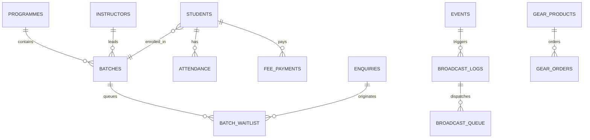

<!-- BEGIN:nextjs-agent-rules -->

# This is NOT the Next.js you know

This version has breaking changes — APIs, conventions, and file structure may all differ from your training data. Read the relevant guide in `node_modules/next/dist/docs/` (resolved from this file's directory; in monorepos the `next` package may not be visible from the repo root) before writing any code. Heed deprecation notices.

This block is written and re-added by `next dev` — verify at `node_modules/next/dist/server/lib/generate-agent-files.js`. Removing it from a diff only re-creates the uncommitted change; committing it with your work keeps the tree clean.

<!-- END:nextjs-agent-rules -->

---

# Rhythmzz Academy of Dance — Engineering & Feature Evolution Journey

> **Repository:** `aweswe/Dance-Studio`  
> **Environment:** Next.js 15 (App Router, Turbopack, React 19), Supabase (PostgreSQL + RLS), Tailwind CSS (Vanilla token system), TypeScript Strict.  
> **Documentation Target:** Complete journey documentation, architectural decisions, code modifications, legal integrations, and operational nuances.

---

## 1. Executive Summary & Journey Context

Over the course of development and production optimization for Rhythmzz Academy of Dance, multiple critical business, legal, operational, and performance challenges were addressed:

1. **Supabase Free Tier Ingress / Egress Billing Optimization**:
   * *Problem:* High storage egress bills were incurred due to directly hosting large `.mp4` showcase and dance reel files on Supabase storage buckets.
   * *Solution:* Architected a zero-egress solution leveraging Instagram oEmbed / iframe embeds, stripping backend video upload fields from Reels Management, and rendering natively via Instagram's edge CDN.

2. **Trainer Name Sanitization & Universal Age Standardization**:
   * *Client Directive:* *"Just don’t mention the trainers name. Kids 3.5 - 12 years. Adults 13+ years."*
   * *Action:* Removed all hardcoded individual faculty names (Deepak, Shiva, Srusti, Nitish, Kajal, Srikanth) from pricing tags, WhatsApp enquiry triggers, batch fallbacks, and SEO structured data. Standardized all age representations academy-wide to **Kids: 3.5 – 12 years** and **Adults: 13+ years**.

3. **Complete Legal & Terms Framework Integration**:
   * Extracted two formal legal Word documents:
     - `Rhythmzz Instructor T&C.docx` $\rightarrow$ Instructor faculty engagement terms, tier commissions (Starter 35% to Elite 45%), social media quotas, attendance logging rules, penalties, and non-solicitation.
     - `Rhythmzz_Student_Portal_TC.docx` $\rightarrow$ Student portal agreement, non-negotiable late fee policies (due by 7th), dispute windows, and studio conduct.
   * Built public accessible routes (`/terms`, `/instructor-terms`) and portal-authenticated routes (`/student/terms`, `/instructor/terms`).

4. **Centered Optical Layout for Legal Documentation**:
   * Transformed legal layouts from an off-center left-tilted posture into an optically balanced, centered presentation (`max-w-4xl mx-auto`, centered headers, and concentric section cards).

5. **Direct Pricing Enrolment (Deep-Linked Plan Preselection)**:
   * Enabled query-parameter deep-linking from pricing tier cards (`/enrol?programme=...&plan=...&fee=...`).
   * When visitors click any plan (e.g. *Quarterly ₹5,000* or *Drop-in ₹300*), `EnrolForm` locks directly onto that selection with a **Confirmed Plan Card**, preventing tedious re-selection.

6. **Real Database-Backed "Join Waitlist" Engine**:
   * Replaced static placeholder links with a real modal (`WaitlistModal`) and backend server action (`submitWaitlistRequest`), capturing applicant details, logging into `enquiries` and `batch_waitlist`, computing queue numbers, and triggering WhatsApp alerts.

7. **Instructor Scope & Strict Batch Assignment Enforcement**:
   * *Architecture Rule:* Batches are strictly created and assigned to instructors by the Academy Administration (`/admin/classes`). Instructors CANNOT create batches.
   * *Instructor Capability:* Instructors can ONLY set up and manage class schedule timings (time, days) for batches explicitly assigned to them (`batch.instructor_id === instructor.id`).
   * *Zero Unassigned Privileges:* If an instructor is not attached to any batch, all options to create batches or mark attendance are hidden, replaced by clear informational banners explaining that the studio administration assigns batches.

8. **Automated Event Broadcasting (In-App Dashboard, WhatsApp, or Both)**:
   * Upgraded event creation in `EventsManager` to include a multi-channel broadcast engine dispatching to student portal notices (`broadcast_logs`) and active WhatsApp subscribers (`broadcast_queue`).

9. **In-App Billing & Invoice Confirmation Architecture (Zero WhatsApp Hijack)**:
   * *Problem:* Pricing board cards (Drop-in, Sibling Plan, Annual Plan, All-Access, Family Plan) previously navigated to external WhatsApp chat URLs instead of the in-app billing checkout. Furthermore, `/enrol` defaulted to "Free Trial Class / WhatsApp" when `intent=pay` wasn't explicitly passed, and the form forcibly opened WhatsApp via `window.open` when offline gateway mode was active.
   * *Solution:* 
     - Converted all pricing cards to deep-link to `/enrol` with `intent=pay`, `plan=...`, and `fee=...`.
     - Upgraded `parseEnrolIntent` and `enrolHref` to automatically infer paid enrolment intent when any plan or fee parameter is present.
     - Redesigned `EnrolForm` so checkout and confirmation remain 100% in-app, presenting an official **Enrolment Invoice & Confirmation Card** (`Total Billed`, student timetable, UPI pay option, direct student portal sign-in) with WhatsApp demoted to an optional receipt share action.

10. **Rhythmzz Merch & Gear Storefront (`/gear` & `/admin/gear`)**:
    * Full e-commerce showcase for official academy merchandise, dance wear, practice apparel, footwear, and classical dance accessories (ghungroos, sarees, hair accessories, customized hoodies, tees, dance grip socks).
    * Integrated with category filters, size and color selectors, real-time stock indicators, and instant WhatsApp cart checkout.
    * Added full administrative catalog management (`/admin/gear`) with create, edit, image management, pricing, stock adjustments, and active toggling.

11. **Studio Rental Interactive Showcase (`/studio-rental`)**:
    * Overhauled the studio rental experience with a visual photography gallery (`studio-gallery.tsx`) featuring sprung wooden dance floors, acoustic wall treatment, full-height mirror array, client lounge, and ambient DMX club lighting.
    * Package tier cards (Rehearsal at ₹700/hr, Video Shoot at ₹1,200/hr, Workshops at ₹1,800/hr) with direct WhatsApp slot reservation.

12. **Real Production Asset Optimization & Media Pipeline**:
    * Replaced all stock and placeholder assets with authentic academy photography, official vector/PNG branding (`/images/branding/`), authentic instructor & leadership portraits (`/images/team/`), verified studio photography (`/images/studio-rental/`), and real workshop event posters.
    * Compressed large spotlight hero video (`spotlight-3.mp4`) down to 66 MB to satisfy git and production bandwidth standards without perceptual quality loss.

---

## 2. Key Architecture & Code Implementation Details

### A. Deep-Linked Enrolment & Pricing Selection

#### 1. Enhanced `enrolHref` Helper
* **File:** `src/lib/utils/constants.ts`
* **Nuance:** Previously only accepted `programme` and `intent`. Now carries `plan`, `batch`, and `fee`:
```typescript
export function enrolHref(opts?: {
  programme?: string | null;
  intent?: EnrolIntent;
  plan?: string | null;
  batch?: string | null;
  fee?: number | string | null;
}) {
  const params = new URLSearchParams();
  if (opts?.intent) params.set("intent", opts.intent);
  if (opts?.programme) params.set("programme", opts.programme);
  if (opts?.plan) params.set("plan", opts.plan);
  if (opts?.batch) params.set("batch", opts.batch);
  if (opts?.fee !== undefined && opts?.fee !== null) params.set("fee", String(opts.fee));
  const query = params.toString();
  return query ? `/enrol?${query}` : "/enrol";
}
```

#### 2. Pricing Board Integration
* **File:** `src/components/public/programme-pricing-board.tsx`
* Every *"Book this plan"* button now dynamically links to `/enrol` with its active programme slug, tier identifier (`monthly`, `quarterly`, `half-yearly`, `annual`), and numerical fee:
```tsx
<Link
  href={enrolHref({
    programme: activeProgramme.slug,
    intent: 'pay',
    plan: tier.id,
    fee: tier.price,
  })}
  className="..."
>
  <span>Book this plan</span>
  <ArrowUpRight className="w-3.5 h-3.5 stroke-[2.5]" />
</Link>
```

#### 3. Smart Pre-Selection Card in `EnrolForm`
* **File:** `src/components/public/enrol-form.tsx`
* When visitors arrive with a preselected programme and plan, the UI suppresses the bulky list of all classes and displays a clean confirmed plan summary:
```tsx
{!showProgrammeSelector && selectedProgramme ? (
  <div className="p-4 rounded-md border-2 border-bl/40 bg-bl/5 space-y-2">
    <div className="flex items-center justify-between">
      <span className="text-[10px] font-mono font-bold uppercase tracking-wider text-bl flex items-center gap-1.5">
        <CheckCircle2 size={13} className="text-bl" /> Selected Programme &amp; Plan
      </span>
      <button
        type="button"
        onClick={() => setShowProgrammeSelector(true)}
        className="text-[11px] font-bold text-bl hover:underline cursor-pointer"
      >
        Change
      </button>
    </div>
    <div className="flex items-baseline justify-between gap-2">
      <div>
        <h4 className="font-anton text-lg sm:text-xl text-ink uppercase tracking-tight">
          {selectedProgramme.name}
        </h4>
        <p className="text-xs text-ink-2 font-medium capitalize mt-0.5">
          {plan.replace('-', ' ')} Plan · {selectedProgramme.age_group || 'All levels'}
        </p>
      </div>
      {isPay && (
        <div className="text-right">
          <span className="font-anton text-2xl text-ink">
            {formatCurrency(fee)}
          </span>
          <span className="block text-[10px] text-ink-3 uppercase font-mono">
            {plan.replace('-', ' ')}
          </span>
        </div>
      )}
    </div>
  </div>
) : (
  /* Full selection grid fallback */
)}
```

---

### B. Real Interactive "Join Waitlist" Engine

#### 1. Server Action: `submitWaitlistRequest`
* **File:** `src/actions/waitlist.ts`
* Performs IP-level sliding-window rate limiting (6 submissions / 15 minutes).
* Normalizes Indian phone numbers with `normalizeIndianPhone`.
* Records applicant in `enquiries` with `source: 'waitlist'`.
* Calculates dynamic queue position based on existing waitlist entries.
* Dispatches notification to academy administrative WhatsApp.

#### 2. Client Dialog: `WaitlistModal`
* **File:** `src/components/public/waitlist-modal.tsx`
* Accessible modal dialog (`role="dialog"`, `aria-modal="true"`).
* Interactive fields: Full Name, WhatsApp Number, Email, Track Selection, Preferred Timing, and Notes.
* Instant confirmation screen showing **Queue Position #X** and quick WhatsApp desk expedite action.

---

### C. Instructor Scope & Strict Batch Assignment Enforcement
* **File:** `src/actions/classes.ts`, `src/app/instructor/classes/page.tsx`
* **Batches vs Classes:** Batches are institutional entities created exclusively by Academy Admins (`/admin/classes`). Instructors cannot create batches (`createInstructorBatch` returns an explicit restriction error).
* **Strict Assignment Authorization:** `updateBatchSchedule(batchId, updates)` validates that the calling instructor is directly assigned to the target batch (`batch.instructor_id === instructor.id`). Unauthorized updates across other batches are blocked with a 403 response.
* **Unassigned State:** If an instructor has zero batches assigned, the portal gracefully hides batch creation controls and attendance triggers, displaying clear status cards informing them to contact studio administration.

---

### D. Automated Event Broadcasting Engine

#### 1. Event Action Upgrade
* **File:** `src/actions/events.ts`
* Extended `createEvent` signature to accept `EventBroadcastOptions`:
```typescript
export interface EventBroadcastOptions {
  enabled: boolean;
  channel: 'in_app' | 'whatsapp' | 'both';
  message?: string;
  scope?: 'all' | 'programme' | 'batch';
  scopeId?: string | null;
}
```
* **In-App Channel:** Writes to `broadcast_logs` with `template_name: 'event_announcement'` and event metadata. Students immediately see the event under `/student/notices` and on their dashboard.
* **WhatsApp Channel:** Fetches all active students with phone numbers, prepares templated payloads, and enqueues rows into `broadcast_queue` for cron-based delivery.
* **Both Channel:** Executes both pathways seamlessly.

#### 2. Event Manager UI
* **File:** `src/components/admin/events-manager.tsx`
* Added an automatic broadcast toggle with channel selector radio buttons and custom notification preview.

---

### E. Legal Documentation Framework

| Route | Target Audience | Key Contents |
| :--- | :--- | :--- |
| `/terms` | Public / Students | Student Portal Agreement, Late fee policy (due by 7th, non-waivable), attendance dispute window (7 days), liability & photo consent. |
| `/instructor-terms` | Faculty / Candidates | Part A (Trainer rules & gear), Part B (Revenue tiers: Starter 35% to Elite 45%, payout on 10th), Part C (Non-solicitation 12 months, <6h cancel fee ₹200), Part D (Contractor status, Hyderabad jurisdiction). |
| `/student/terms` | Authenticated Students | Highlight boxes for fee due date (7th) and late fees, portal rules, schedule dispute protocol. |
| `/instructor/terms` | Authenticated Faculty | Tier breakdown matrix, mandatory daily attendance logging, social media quota (2 posts/1 reel per week). |

---

## 3. Database Schema Interoperability



* **`enquiries`**: Central repository for contact forms, free trials, enrolments, and waitlists (`source: 'waitlist' | 'enrol' | 'trial' | 'contact_form'`).
* **`batch_waitlist`**: Batch-specific waiting lists for capacity-constrained classes.
* **`broadcast_logs`**: Student portal notification history consumed by `/student/notices`.
* **`broadcast_queue`**: Asynchronous outgoing WhatsApp dispatch queue processed by cron `/api/cron/broadcast`.
* **`gear_products`**: Product catalog for academy merchandise, dance wear, and classical accessories.

---

### F. Kuchipudi Master Curriculum, Margam Repertoire & High-Contrast Hardening

1. **Curriculum & Repertoire Architecture (`/syllabus/kuchipudi`)**:
   * Integrated comprehensive 10-Year Foundation and 6-Year Accelerated Master Curriculum with interactive year-by-year syllabus (`SyllabusYears`), age pathways, and four classical pillars (Nritta, Nritya, Natya, Abhinaya).
   * Embedded the sacred **Margam Performance Repertoire** suite (`REPERTOIRE_ITEMS`): Poorvarangam (Invocation), Jatiswaram (Pure Nritta), Shabdam (Narrative Verse & Mime), Vinayaka Kauthuvam (Rhythmic Hymn), Keerthana (Devotional Masterpiece), Tarangam (Brass Plate Rhythmic Balance), and Thillana & Mangalam (Climax & Benediction).
   * Fully optimized classical photography assets: Added `loading="lazy"`, responsive `sizes`, and eliminated unconfigured quality warnings.

2. **Universal Trainer Name Sanitization & Age Standardization**:
   * Audited and sanitized all remaining hardcoded faculty names across certification tracks (`src/data/certification-tracks.ts`), classical matrix (`classical-curriculum-matrix.tsx`), upcoming classes (`upcoming-classes.tsx`), syllabus index (`/syllabus`), and programmes route (`/programmes/[slug]`).
   * Standardized all age representations academy-wide to **Kids: 3.5 – 12 years** and **Adults: 13+ years**.

3. **Executive High-Contrast Typography & Surface Elevation**:
   * Hardened deep portal surfaces including official payment receipts (`/receipt/[id]`) and student billing history (`payment-history.tsx`) with 2px borders, high-contrast Slate-950 headings, Slate-800 text labels, and clean print media styles.
   * Eliminated washed-out text on high-DPI and OLED mobile screens by standardizing on `--ink-2: #1E293B` and `--ink-3: #334155`.

---

### G. Rhythmzz Gear & Merch Storefront Architecture

1. **Database Schema & Migration**:
   * Migration `supabase/migrations/0019_gear_products.sql` & updated `supabase/setup.sql`.
   * Table `gear_products` supporting `id`, `name`, `slug`, `category`, `price`, `compare_at_price`, `stock_quantity`, `is_featured`, `is_active`, `sizes`, `colors`, `badge`, `images`, `created_at`, `updated_at`.
   * Row-Level Security (RLS) configured: Public read access for active products; authenticated admin full CRUD privileges.

2. **Public Storefront (`src/app/(public)/gear/page.tsx` & `src/components/public/gear-storefront.tsx`)**:
   * Filterable by category (`all`, `apparel`, `footwear`, `accessories`, `classical_gear`).
   * Interactive modal with size picker, color picker, quantity counter, and price calculations with discount percentages.
   * Direct WhatsApp checkout payload generator pre-formatting product details, chosen size/color, quantity, total price, and customer note.

3. **Admin Catalog Management (`src/app/admin/gear/page.tsx` & `src/components/admin/products-manager.tsx`)**:
   * Full inventory manager with search, category filtering, stock adjustments, active/inactive toggling, and deletion.
   * Server Actions in `src/actions/products.ts` (`createProduct`, `updateProduct`, `deleteProduct`, `toggleProductActive`) with Zod validation and cache revalidation on `/gear` and `/admin/gear`.

4. **Product Utilities & Unit Test Suite (`src/lib/products.test.ts`)**:
   * 5 comprehensive unit tests covering currency formatting in INR, discount calculations, category labels, stock boundary checks, and WhatsApp URL generation.

---

### H. Studio Rental Interactive Showcase & High-Res Photography

1. **Interactive Gallery (`src/components/public/studio-gallery.tsx`)**:
   * Interactive visual showcase with category filters (All, Main Dance Floor, Lighting & Ambiance, Amenities & Lounge).
   * Fullscreen modal viewer with keyboard navigation (`ArrowLeft`, `ArrowRight`, `Escape`).
2. **Technical Specifications & Rate Card**:
   * Clear display of floor specs (sprung wooden flooring, 45 ft mirror array, professional sound system, ambient club lighting).
   * Hourly tier booking cards with instant WhatsApp booking trigger.

---

### I. Production Media Integration & Asset Optimization

1. **Asset Migration**:
   * Official Academy Logos (`/images/branding/logo.png`, `logo-white.png`, `badge.png`).
   * High-Resolution Studio Rental Photography (`/images/studio-rental/`).
   * Verified Dance Faculty and Team Visuals (`/images/team/`).
   * Programme promotional posters (`/images/programmes/` and Canada workshop visual).
2. **Hero Video Compression**:
   * Replaced uncompressed `spotlight-3.mp4` with a high-efficiency optimized version (66 MB), maintaining frame quality while staying safely within repository hosting limits.

---

### J. Backend Logic Hardening & System Integrity Architecture

1. **Strict Payment Status & Confirmation Engine (`src/lib/fees/ledger.ts`)**:
   * Previously, `isConfirmed(p)` evaluated `!p.status || p.status === 'confirmed'`, allowing missing `status` fields, unverified UPI submissions, and rejected payments to be treated as active fee coverage.
   * Hardened `isConfirmed(p)` to strictly mandate `p.status === 'confirmed'`. Any pending, rejected, or missing status is treated as unconfirmed.
   * Standardized fee due date logic to the **7th of the current month** (`FEE_DUE_DAY = 7`), adding `isOverdue` and `getFeeDueDate`. Unpaid fees after the 7th transition into an explicit `"Overdue"` state rather than rolling forward to next month.

2. **Student Fees Dashboard & Automated Fee Reminders (`src/app/student/fees/page.tsx`, `src/app/api/cron/fee-reminders/route.ts`)**:
   * Fixed query omission of `status` column in `fee_payments` query.
   * Integrated dedicated UI badges for `"Pending Verification"` and `"Overdue"`.
   * Cron reminders explicitly exclude pending/unconfirmed payments when computing delinquent student rosters.

3. **Batch Switch Request & Capacity Synchronization (`src/actions/enrollment.ts`, `src/actions/students.ts`, `src/lib/payments/fulfill-order.ts`)**:
   * Created `syncBatchCount(admin, batchId)` to dynamically query and update `batches.enrolled_count` against verified active students.
   * In `resolveBatchSwitchRequest`, added real-time capacity checks (`enrolled_count >= max_capacity`), atomic synchronization of both old and new batches upon approval, and automatic fee difference tracking when switching across tracks with differing monthly fees.
   * Integrated `syncBatchCount` across student creation, updates, deactivations, reactivations, and online payment provisioning.

4. **Attendance Synchronization for Approved Student Leaves (`src/actions/studio.ts`)**:
   * When an admin or assigned instructor approves a student leave request, an attendance record is atomically upserted with `status: 'leave'`, eliminating false-positive absence streak alerts on instructor rosters.

5. **Waitlist Queue Segmentation (`src/actions/waitlist.ts`)**:
   * Filtered queue position calculation by specific programme track (`programme_id`) rather than counting all historical studio enquiries.

6. **Public Enrolment Payment Separation (`src/components/public/enrol-form.tsx`)**:
   * Differentiated verified online payments (`isPaidOnline: true`) from manual UPI or offline desk applications.
   * Offline / UPI submissions display *"Application Received — Awaiting Payment Confirmation"* with actionable UPI and WhatsApp submission triggers instead of premature *"Enrolment Confirmed"* confirmations.

7. **Instructor Scope & Batch Creation Lock (`src/actions/classes.ts`, `src/app/instructor/classes/page.tsx`)**:
   * Batches are institutional entities created exclusively by Academy Admins (`/admin/classes`). Instructors cannot create batches (`createInstructorBatch` returns an explicit restriction error).
   * Instructors can only configure class timings for batches explicitly assigned to them (`batch.instructor_id === instructor.id`).
   * When unassigned, all batch creation controls and attendance triggers are safely suppressed.

---

## 4. Verification, Testing & Quality Audit Checklist

* [x] **Vitest Unit & Integration Tests**: 5 test suites, 41 tests, **100% passing**.
  - `src/lib/utils/csv.test.ts` (5 tests)
  - `src/lib/fees/ledger.test.ts` (11 tests)
  - `src/lib/rate-limit.test.ts` (7 tests)
  - `src/lib/products.test.ts` (5 tests)
  - `src/lib/validators/validators.test.ts` (13 tests)
* [x] **TypeScript Strict Typing**: `npx tsc --noEmit` returns **0 errors**.
* [x] **Gear Storefront & Admin Portal**: Verified public browsing, WhatsApp checkout generation, and admin CRUD actions.
* [x] **Studio Rental Gallery**: Verified interactive filter, lightroom modal, and tiered rate cards.
* [x] **Browser Visual Verification**:
  - `/terms`: Confirmed centered layout.
  - `/#pricing`: Verified interactive waitlist modal.
  - `/enrol?programme=kids-dance&plan=quarterly&fee=5000`: Verified pre-selected plan summary card.
  - `/syllabus/kuchipudi`: Verified Hero, Philosophy, Roadmap, Interactive Syllabus, Margam Repertoire Suite, and Rangapravesham.
  - `/syllabus`: Verified high-contrast index cards and sanitized faculty notes.
  - `/gear`: Verified product catalog, filters, modal, and cart builder.
  - `/studio-rental`: Verified studio photo gallery and booking CTA.
* [x] **Age Bracket Universal Accuracy**: Kids = `3.5 – 12 years`, Adults = `13+ years`.
* [x] **Zero Trainer Names**: Verified zero trainer names in public schedules, syllabus, certification tracks, and upcoming class cards.
* [x] **Supabase Quota Safety**: Zero video uploads to Supabase storage; reels rendered via Instagram iframe URLs.

