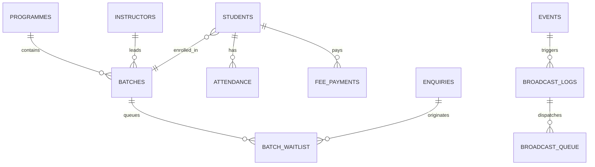

<!-- BEGIN:nextjs-agent-rules -->

# This is NOT the Next.js you know

This version has breaking changes — APIs, conventions, and file structure may all differ from your training data. Read the relevant guide in `node_modules/next/dist/docs/` (resolved from this file's directory; in monorepos the `next` package may not be visible from the repo root) before writing any code. Heed deprecation notices.

This block is written and re-added by `next dev` — verify at `node_modules/next/dist/server/lib/generate-agent-files.js`. Removing it from a diff only re-creates the uncommitted change; committing it with your work keeps the tree clean.

<!-- END:nextjs-agent-rules -->

---

# Rhythmzz Academy of Dance — Engineering & Feature Evolution Journey

> **Repository:** `aweswe/Dance-Studio`  
> **Environment:** Next.js 15 (App Router, Turbopack, React 19), Supabase (PostgreSQL + RLS), Tailwind CSS (Vanilla token system), TypeScript Strict.  
> **Documentation Target:** Complete journey documentation, architectural decisions, code modifications, legal integrations, and operational nuances.

---

## 1. Executive Summary & Journey Context

Over the course of development and production optimization for Rhythmzz Academy of Dance, multiple critical business, legal, operational, and performance challenges were addressed:

1. **Supabase Free Tier Ingress / Egress Billing Optimization**:
   * *Problem:* High storage egress bills were incurred due to directly hosting large `.mp4` showcase and dance reel files on Supabase storage buckets.
   * *Solution:* Architected a zero-egress solution leveraging Instagram oEmbed / iframe embeds, stripping backend video upload fields from Reels Management, and rendering natively via Instagram's edge CDN.

2. **Trainer Name Sanitization & Universal Age Standardization**:
   * *Client Directive:* *"Just don’t mention the trainers name. Kids 3.5 - 12 years. Adults 13+ years."*
   * *Action:* Removed all hardcoded individual faculty names (Deepak, Shiva, Srusti, Nitish, Kajal, Srikanth) from pricing tags, WhatsApp enquiry triggers, batch fallbacks, and SEO structured data. Standardized all age representations academy-wide to **Kids: 3.5 – 12 years** and **Adults: 13+ years**.

3. **Complete Legal & Terms Framework Integration**:
   * Extracted two formal legal Word documents:
     - `Rhythmzz Instructor T&C.docx` $\rightarrow$ Instructor faculty engagement terms, tier commissions (Starter 35% to Elite 45%), social media quotas, attendance logging rules, penalties, and non-solicitation.
     - `Rhythmzz_Student_Portal_TC.docx` $\rightarrow$ Student portal agreement, non-negotiable late fee policies (due by 7th), dispute windows, and studio conduct.
   * Built public accessible routes (`/terms`, `/instructor-terms`) and portal-authenticated routes (`/student/terms`, `/instructor/terms`).

4. **Centered Optical Layout for Legal Documentation**:
   * Transformed legal layouts from an off-center left-tilted posture into an optically balanced, centered presentation (`max-w-4xl mx-auto`, centered headers, and concentric section cards).

5. **Direct Pricing Enrolment (Deep-Linked Plan Preselection)**:
   * Enabled query-parameter deep-linking from pricing tier cards (`/enrol?programme=...&plan=...&fee=...`).
   * When visitors click any plan (e.g. *Quarterly ₹5,000* or *Drop-in ₹300*), `EnrolForm` locks directly onto that selection with a **Confirmed Plan Card**, preventing tedious re-selection.

6. **Real Database-Backed "Join Waitlist" Engine**:
   * Replaced static placeholder links with a real modal (`WaitlistModal`) and backend server action (`submitWaitlistRequest`), capturing applicant details, logging into `enquiries` and `batch_waitlist`, computing queue numbers, and triggering WhatsApp alerts.

7. **Instructor Self-Service Batch & Class Scheduling**:
   * Added `createInstructorBatch` server action and `CreateInstructorBatchDialog` to the instructor portal, enabling instructors to schedule and activate their own classes.

8. **Automated Event Broadcasting (In-App Dashboard, WhatsApp, or Both)**:
   * Upgraded event creation in `EventsManager` to include a multi-channel broadcast engine dispatching to student portal notices (`broadcast_logs`) and active WhatsApp subscribers (`broadcast_queue`).

---

## 2. Key Architecture & Code Implementation Details

### A. Deep-Linked Enrolment & Pricing Selection

#### 1. Enhanced `enrolHref` Helper
* **File:** `src/lib/utils/constants.ts`
* **Nuance:** Previously only accepted `programme` and `intent`. Now carries `plan`, `batch`, and `fee`:
```typescript
export function enrolHref(opts?: {
  programme?: string | null;
  intent?: EnrolIntent;
  plan?: string | null;
  batch?: string | null;
  fee?: number | string | null;
}) {
  const params = new URLSearchParams();
  if (opts?.intent) params.set("intent", opts.intent);
  if (opts?.programme) params.set("programme", opts.programme);
  if (opts?.plan) params.set("plan", opts.plan);
  if (opts?.batch) params.set("batch", opts.batch);
  if (opts?.fee !== undefined && opts?.fee !== null) params.set("fee", String(opts.fee));
  const query = params.toString();
  return query ? `/enrol?${query}` : "/enrol";
}
```

#### 2. Pricing Board Integration
* **File:** `src/components/public/programme-pricing-board.tsx`
* Every *"Book this plan"* button now dynamically links to `/enrol` with its active programme slug, tier identifier (`monthly`, `quarterly`, `half-yearly`, `annual`), and numerical fee:
```tsx
<Link
  href={enrolHref({
    programme: activeProgramme.slug,
    intent: 'pay',
    plan: tier.id,
    fee: tier.price,
  })}
  className="..."
>
  <span>Book this plan</span>
  <ArrowUpRight className="w-3.5 h-3.5 stroke-[2.5]" />
</Link>
```

#### 3. Smart Pre-Selection Card in `EnrolForm`
* **File:** `src/components/public/enrol-form.tsx`
* When visitors arrive with a preselected programme and plan, the UI suppresses the bulky list of all classes and displays a clean confirmed plan summary:
```tsx
{!showProgrammeSelector && selectedProgramme ? (
  <div className="p-4 rounded-md border-2 border-bl/40 bg-bl/5 space-y-2">
    <div className="flex items-center justify-between">
      <span className="text-[10px] font-mono font-bold uppercase tracking-wider text-bl flex items-center gap-1.5">
        <CheckCircle2 size={13} className="text-bl" /> Selected Programme &amp; Plan
      </span>
      <button
        type="button"
        onClick={() => setShowProgrammeSelector(true)}
        className="text-[11px] font-bold text-bl hover:underline cursor-pointer"
      >
        Change
      </button>
    </div>
    <div className="flex items-baseline justify-between gap-2">
      <div>
        <h4 className="font-anton text-lg sm:text-xl text-ink uppercase tracking-tight">
          {selectedProgramme.name}
        </h4>
        <p className="text-xs text-ink-2 font-medium capitalize mt-0.5">
          {plan.replace('-', ' ')} Plan · {selectedProgramme.age_group || 'All levels'}
        </p>
      </div>
      {isPay && (
        <div className="text-right">
          <span className="font-anton text-2xl text-ink">
            {formatCurrency(fee)}
          </span>
          <span className="block text-[10px] text-ink-3 uppercase font-mono">
            {plan.replace('-', ' ')}
          </span>
        </div>
      )}
    </div>
  </div>
) : (
  /* Full selection grid fallback */
)}
```

---

### B. Real Interactive "Join Waitlist" Engine

#### 1. Server Action: `submitWaitlistRequest`
* **File:** `src/actions/waitlist.ts`
* Performs IP-level sliding-window rate limiting (6 submissions / 15 minutes).
* Normalizes Indian phone numbers with `normalizeIndianPhone`.
* Records applicant in `enquiries` with `source: 'waitlist'`.
* Calculates dynamic queue position based on existing waitlist entries.
* Dispatches notification to academy administrative WhatsApp.

#### 2. Client Dialog: `WaitlistModal`
* **File:** `src/components/public/waitlist-modal.tsx`
* Accessible modal dialog (`role="dialog"`, `aria-modal="true"`).
* Interactive fields: Full Name, WhatsApp Number, Email, Track Selection, Preferred Timing, and Notes.
* Instant confirmation screen showing **Queue Position #X** and quick WhatsApp desk expedite action.

---

### C. Instructor Self-Service Batch Management

#### 1. Server Action: `createInstructorBatch`
* **File:** `src/actions/classes.ts`
* Securely retrieves instructor record linked to authenticated user.
* Validates inputs (name length, valid programme ID, at least one weekday).
* Inserts new batch with `instructor_id: instructor.id` and revalidates relevant paths.

#### 2. Instructor UI: `CreateInstructorBatchDialog`
* **File:** `src/components/instructor/create-batch-dialog.tsx`
* Integrated into `/instructor/classes`.
* Provides interactive weekday selection pills (Mon-Sun), start/end time pickers, and capacity config.

---

### D. Automated Event Broadcasting Engine

#### 1. Event Action Upgrade
* **File:** `src/actions/events.ts`
* Extended `createEvent` signature to accept `EventBroadcastOptions`:
```typescript
export interface EventBroadcastOptions {
  enabled: boolean;
  channel: 'in_app' | 'whatsapp' | 'both';
  message?: string;
  scope?: 'all' | 'programme' | 'batch';
  scopeId?: string | null;
}
```
* **In-App Channel:** Writes to `broadcast_logs` with `template_name: 'event_announcement'` and event metadata. Students immediately see the event under `/student/notices` and on their dashboard.
* **WhatsApp Channel:** Fetches all active students with phone numbers, prepares templated payloads, and enqueues rows into `broadcast_queue` for cron-based delivery.
* **Both Channel:** Executes both pathways seamlessly.

#### 2. Event Manager UI
* **File:** `src/components/admin/events-manager.tsx`
* Added an automatic broadcast toggle with channel selector radio buttons and custom notification preview.

---

### E. Legal Documentation Framework

| Route | Target Audience | Key Contents |
| :--- | :--- | :--- |
| `/terms` | Public / Students | Student Portal Agreement, Late fee policy (due by 7th, non-waivable), attendance dispute window (7 days), liability & photo consent. |
| `/instructor-terms` | Faculty / Candidates | Part A (Trainer rules & gear), Part B (Revenue tiers: Starter 35% to Elite 45%, payout on 10th), Part C (Non-solicitation 12 months, <6h cancel fee ₹200), Part D (Contractor status, Hyderabad jurisdiction). |
| `/student/terms` | Authenticated Students | Highlight boxes for fee due date (7th) and late fees, portal rules, schedule dispute protocol. |
| `/instructor/terms` | Authenticated Faculty | Tier breakdown matrix, mandatory daily attendance logging, social media quota (2 posts/1 reel per week). |

---

## 3. Database Schema Interoperability



* **`enquiries`**: Central repository for contact forms, free trials, enrolments, and waitlists (`source: 'waitlist' | 'enrol' | 'trial' | 'contact_form'`).
* **`batch_waitlist`**: Batch-specific waiting lists for capacity-constrained classes.
* **`broadcast_logs`**: Student portal notification history consumed by `/student/notices`.
* **`broadcast_queue`**: Asynchronous outgoing WhatsApp dispatch queue processed by cron `/api/cron/broadcast`.

---

## 4. Verification, Testing & Quality Audit Checklist

* [x] **Vitest Unit & Integration Tests**: 4 test suites, 35 tests, **100% passing**.
* [x] **TypeScript Strict Typing**: `npx tsc --noEmit` returns **0 errors**.
* [x] **Browser Visual Verification**:
  - `/terms`: Confirmed centered layout (`terms_page_centered_1791897119556.png`).
  - `/#pricing`: Verified interactive waitlist modal (`waitlist_modal_open_1791897176108.png`).
  - `/enrol?programme=kids-dance&plan=quarterly&fee=5000`: Verified pre-selected plan summary card (`enrol_preselected_card_1791897180590.png`).
* [x] **Age Bracket Universal Accuracy**: Kids = `3.5 – 12 years`, Adults = `13+ years`.
* [x] **Zero Trainer Names**: Verified zero trainer names in pricing cards, schedule fallbacks, or marketing blurbs.
* [x] **Supabase Quota Safety**: Zero video uploads to Supabase storage; reels rendered via Instagram iframe URLs.
