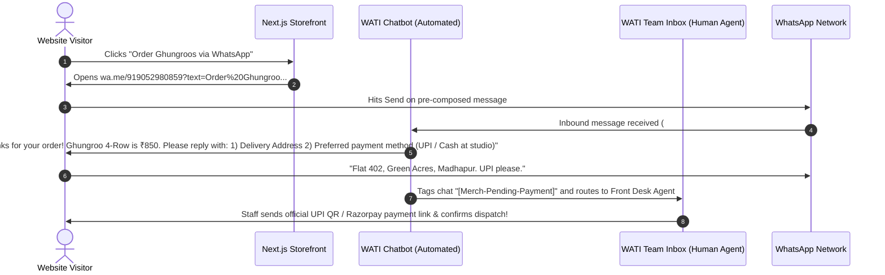
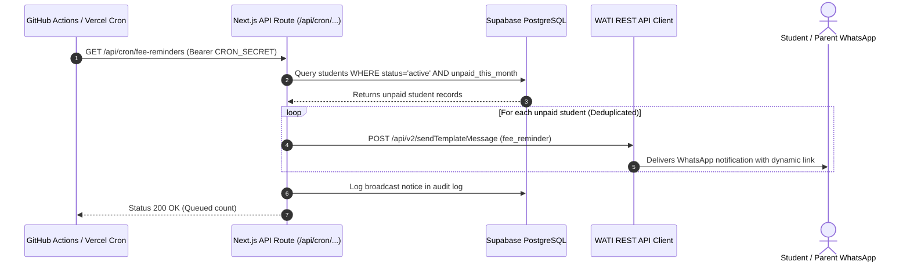

# Rhythmzz Academy of Dance — WhatsApp Automation Blueprint & WATI Plan Feasibility

**Document Status:** Production Architecture Blueprint  
**Target Platform:** WATI (WhatsApp Business API Provider) + Next.js / Supabase Backend  
**Recommended Tier:** WATI Growth Plan (₹2,699/month)  
**Author / Engineering Team:** Rhythmzz Tech & Operations  
**Date:** October 2026  

---

## Table of Contents
1. [Executive Summary & Verdict](#1-executive-summary--verdict)
2. [The Core Distinction: Chatbot Triggers vs Outbound API Calls](#2-the-core-distinction-chatbot-triggers-vs-outbound-api-calls)
3. [Master Automation Inventory (14 Full-Fledged Flows)](#3-master-automation-inventory-14-full-fledged-flows)
   - [Category A: Operational & Transactional Flows (Existing in Codebase)](#category-a-operational--transactional-flows-existing-in-codebase)
   - [Category B: E-Commerce & Dance Merchandise Flow](#category-b-e-commerce--dance-merchandise-flow)
   - [Category C: Growth, Retention & Student Lifecycle Flows](#category-c-growth-retention--student-lifecycle-flows)
4. [Automation Depth & Technical Architecture](#4-automation-depth--technical-architecture)
   - [Depth Classification (Levels 1, 2, 3)](#depth-classification-levels-1-2-3)
   - [Merchandise Order Architecture Sequence](#merchandise-order-architecture-sequence)
   - [Fee Reminder & Class Schedule Sequence](#fee-reminder--class-schedule-sequence)
5. [WATI Growth Plan (₹2,699/mo) Comprehensive Feasibility](#5-wati-growth-plan-2699mo-comprehensive-feasibility)
   - [Feature-by-Feature Capacity Analysis](#feature-by-feature-capacity-analysis)
   - [Meta Conversation Costs & Pricing Nuances (India)](#meta-conversation-costs--pricing-nuances-india)
   - [Total Cost of Ownership (Monthly Projection)](#total-cost-of-ownership-monthly-projection)
6. [Meta-Approved Template Registry (Production Copy)](#6-meta-approved-template-registry-production-copy)
7. [Step-by-Step Implementation & Onboarding Playbook](#7-step-by-step-implementation--onboarding-playbook)
8. [Edge Cases, Error Handling & Anti-Spam Rules](#8-edge-cases-error-handling--anti-spam-rules)

---

## 1. Executive Summary & Verdict

### Can we achieve all our planned automations on the WATI Growth Plan (₹2,699/month)?
**YES, 100%.** The WATI Growth plan is the exact sweet spot for Rhythmzz Academy of Dance. You do **not** need the Pro (₹5,999/mo) or Enterprise plans.

### Why Growth is sufficient:
1. **15,000 Outbound Broadcast Messages / month:** All your operational transactional messages (receipts, class reminders, monthly fees) run under this quota. For an active academy of 300–800 students, monthly usage is ~1,500–3,000 messages (less than 20% of the limit).
2. **1,000 Automation Triggers / month:** This applies strictly to inbound chatbot keyword executions (e.g., student inquiring about pricing or ordering merchandise). 1,000 triggers translates to ~33 new bot interactions every single day.
3. **3 Included Team Inbox Users:** Sufficient for **Nitish Kumar (Director)**, the **Front Desk / Receptionist**, and the **Operations / Merchandise Manager**.
4. **Full REST API & Webhooks Access:** Allows our existing Next.js backend (`src/lib/whatsapp/client.ts`) to programmatically dispatch template messages directly via WATI endpoints.

---

## 2. The Core Distinction: Chatbot Triggers vs Outbound API Calls

A major source of confusion with WhatsApp pricing is what constitutes a **"Trigger"** versus an **"API Broadcast"**.

```
┌───────────────────────────────────────────────────────────────────────────────────┐
│                           HOW WATI USAGE IS CALCULATED                            │
├─────────────────────────────────────────┬─────────────────────────────────────────┤
│ OUTBOUND API CALLS (Backend -> WATI)    │ INBOUND CHATBOT TRIGGERS (User -> Bot)  │
├─────────────────────────────────────────┼─────────────────────────────────────────┤
│ • Fee Due Reminders                     │ • User clicks "Order on WhatsApp"       │
│ • Instant Payment Receipts              │ • User texts "FEES", "CLASSES", "JOIN"  │
│ • Welcome Messages                      │ • User taps interactive bot buttons     │
│ • Attendance Absence Alerts             │ • After-hours auto-responder            │
│ • Class Night-Before Reminders          │                                         │
│ • Admin Emergency Broadcasts            │                                         │
├─────────────────────────────────────────┼─────────────────────────────────────────┤
│ Limit: 15,000 messages / month          │ Limit: 1,000 triggers / month           │
│ DOES NOT consume chatbot triggers!      │ Only consumes when bot answers inbound  │
└─────────────────────────────────────────┴─────────────────────────────────────────┘
```

Because 80% of the academy's messaging is server-initiated from Next.js, your chatbot trigger balance will remain well below the 1,000 limit, leaving ample headroom for sales and merchandise inquiries.

---

## 3. Master Automation Inventory (14 Full-Fledged Flows)

### Category A: Operational & Transactional Flows (Existing in Codebase)

These 9 automations are already fully implemented in your codebase (`src/lib/whatsapp/templates.ts`, `src/lib/payments/fulfill-order.ts`, and `src/app/api/cron/`):

| # | Flow Name | Trigger Event | Mechanism & Code Hook | Content & Destination |
|---|---|---|---|---|
| **1** | **Payment Receipt** | Successful Razorpay payment | `src/lib/payments/fulfill-order.ts` (L159-L170) | Sends instant confirmation: Student name, amount (₹), date, Razorpay payment ID. |
| **2** | **Enrolment Welcome & Portal Credentials** | New student registration / batch onboarding | `src/lib/payments/fulfill-order.ts` (L150-L158) | Congratulates student on joining the style/batch, provides student portal login link (`rhythmzz.in/login`). |
| **3** | **Monthly Fee Due Reminder** | Scheduled GitHub Actions Cron (Runs 25th of month at 09:00 IST) | `src/app/api/cron/fee-reminders/route.ts` | Identifies active students with unpaid fees for the month, calculates amount due, generates direct payment link. Auto-deduplicates to prevent double-messaging. |
| **4** | **Night-Before Class Reminder** | Scheduled Cron (Runs daily at 20:00 IST) | `src/app/api/cron/class-reminders/route.ts` | Checks tomorrow’s timetable, matches active batch roster, messages student with batch style, time, and studio hall. |
| **5** | **Absence Check-In & Retention Alert** | Instructor marks student absent 3 times consecutively | `src/actions/attendance.ts` (L90-L113) | Fires a warm personal check-in: *"We missed you in the last 3 sessions! Is everything okay? Let us know if you need a leave pause."* Prevents silent dropouts. |
| **6** | **Studio Rental Approval** | Admin approves rental in dashboard | `src/actions/rentals.ts` (L24-L35) | Confirms rental date, start/end time slot, studio hall assigned, and access rules. |
| **7** | **Studio Rental Decline** | Admin rejects booking request | `src/actions/rentals.ts` | Courteous notice of studio unavailability with option to choose an alternative slot. |
| **8** | **Kuchipudi Certificate Ready** | Admin issues board exam result | `src/actions/kuchipudi.ts` (L105-L117) | Congratulates student on clearing the board examination with level and PDF download URL. |
| **9** | **Emergency & Admin Broadcast Queue** | Admin sends studio announcement | `src/app/api/cron/broadcast/route.ts` | Queued in `broadcast_queue` table and drained in safe throttled batches of 25 to protect WhatsApp sender reputation. |

---

### Category B: E-Commerce & Dance Merchandise Flow

| # | Flow Name | Trigger Event | Mechanism & Code Hook | Content & Destination |
|---|---|---|---|---|
| **10** | **WhatsApp Merchandise Ordering & Human Handoff** | Visitor clicks "Order on WhatsApp" on any product (Ghungroos, Hoodies, Dance Shoes, Yoga Mats) | Pre-composed `wa.me` link from website + WATI Visual Chatbot Flow | 1. User arrives with pre-composed query: `Hi Rhythmzz, I'd like to order: Ghungroo 4-Row (Size: M, Qty: 1) #MERCH-04`.<br>2. WATI Bot instantly acknowledges order, shares product price & studio pickup / courier options.<br>3. Bot collects delivery address & phone.<br>4. Bot tags chat as `[Merchandise Order]` and notifies the Team Inbox for human agent to send Razorpay/UPI payment link and dispatch tracking. |

---

### Category C: Growth, Retention & Student Lifecycle Flows (Recommended Additions)

| # | Flow Name | Trigger Event | Mechanism & Code Hook | Content & Destination |
|---|---|---|---|---|
| **11** | **Free Trial Nudge & Follow-Up Loop** | 24 hours after a prospect attends a trial class | Supabase scheduled sweep or CRM webhook | Asks: *"How was your trial class with Nitish Sir? [Loved it! Enrol Now] [Have Questions]"*. Tapping *"Loved it"* unlocks a ₹500 early-bird coupon valid for 48 hours. |
| **12** | **30-Day Google Review Collector** | Student completes 30 days of active membership | Automated cron checking `students.created_at` | Congratulates student on completing month 1, asks for a quick Google review with direct Google Maps link. Dramatically boosts local SEO in Hyderabad. |
| **13** | **Student Birthday Greeting & Pass** | Student's date of birth matches today | Daily 09:00 IST cron sweep | Personalized birthday wish + complimentary 1-class guest pass for a family member or friend. |
| **14** | **Annual Showcase / Workshop Ticket Reservation** | Event registration opens | Webhook / Broadcast trigger | Sends interactive message with quick-reply buttons: `[Book 2 Tickets]`, `[Book 4 Tickets]`, `[View Show Guide]`. |

---

## 4. Automation Depth & Technical Architecture

### Depth Classification (Levels 1, 2, 3)

```
┌────────────────────────────────────────────────────────────────────────┐
│                        AUTOMATION DEPTH LAYERS                         │
├────────────────────────────────────────────────────────────────────────┤
│ LEVEL 1: One-Way Transactional Backend API                             │
│ • No chatbot logic or menus. Pure server-side POST request.           │
│ • Consumes ZERO WATI automation triggers.                              │
│ • Example: Payment Receipt, Fee Reminder, Class Schedule Notice.       │
├────────────────────────────────────────────────────────────────────────┤
│ LEVEL 2: Two-Way Interactive Keyword Chatbot Flow                      │
│ • Pre-built decision tree using buttons, lists, and keyword matching.  │
│ • Handled entirely by WATI's visual bot builder without human staff.   │
│ • Consumes 1 WATI automation trigger per inbound session.              │
│ • Example: Trial Class Feedback, FAQs, Studio Directions.              │
├────────────────────────────────────────────────────────────────────────┤
│ LEVEL 3: Hybrid Human-in-the-Loop & Team Inbox Handoff                 │
│ • Chatbot qualifies lead / takes order -> passes context to staff.     │
│ • Staff receives push alert on WATI Mobile App (iOS/Android).          │
│ • Staff finishes transaction (custom invoice, UPI QR, courier slip).   │
│ • Example: Merchandise sales, corporate choreography inquiries.        │
└────────────────────────────────────────────────────────────────────────┘
```

---

### Merchandise Order Architecture Sequence



---

### Fee Reminder & Class Schedule Sequence



---

## 5. WATI Growth Plan (₹2,699/mo) Comprehensive Feasibility

### Feature-by-Feature Capacity Analysis

| WATI Growth Plan Feature | Plan Limit | Rhythmzz Academy Needs | Verdict |
|---|---|---|:---:|
| **Monthly Subscription** | ₹2,699 / month | Fits operational budget | **PASS** |
| **Team Inbox Seats** | 3 Users included | 3 users (Nitish Kumar + Front Desk + Ops) | **PASS** |
| **Monthly Outbound Broadcasts** | 15,000 messages / mo | ~2,000–3,500 messages / mo | **PASS (80% buffer)** |
| **Chatbot Automation Triggers** | 1,000 triggers / mo | ~150–350 inbound queries / mo | **PASS (65% buffer)** |
| **REST API & Webhooks Access** | Included | Required for Next.js `sendWhatsAppTemplate()` | **PASS** |
| **Mobile App (iOS & Android)** | Included | Staff reply from their phones without sharing SIM | **PASS** |
| **Visual Flow Builder** | Included | Required for merchandise & FAQ bot | **PASS** |

---

### Meta Conversation Costs & Pricing Nuances (India)

WATI's subscription covers software and API maintenance. In addition, Meta charges micro-fees per 24-hour conversation window:

1. **Service Conversations (Customer-Initiated):**
   - Applies when customer messages you first (e.g. clicking "Buy on WhatsApp" or asking for class timings).
   - **Meta provides the first 1,000 Service Conversations FREE every month per WhatsApp Business Account.**
   - Beyond 1,000: ~₹0.35 per 24-hour window. Inside that 24 hours, both parties can send unlimited messages.
2. **Utility Conversations (Business-Initiated):**
   - Applies to payment receipts, monthly fee reminders, and class schedule alerts.
   - Meta charges **~₹0.35 per conversation** in India.
3. **Marketing Conversations (Business-Initiated):**
   - Applies to holiday workshops, festive offers, and mass marketing broadcasts.
   - Meta charges **~₹0.78 to ₹0.85 per conversation** in India.

---

### Total Cost of Ownership (Monthly Projection)

For an academy with **400 active students** and **150 monthly new inquiries**:

| Expense Component | Monthly Volume | Rate | Total Cost |
|---|---|---|---|
| **WATI Growth Base Fee** | Fixed software cost | Flat rate | ₹2,699 |
| **Payment Receipts (Utility)** | ~400 receipts | ~₹0.35 | ₹140 |
| **Fee Due Reminders (Utility)** | ~150 reminders (for late payers) | ~₹0.35 | ₹52 |
| **Class Reminders (Utility)** | ~800 reminders | ~₹0.35 | ₹280 |
| **Inbound Merch & Inquiries (Service)**| ~150 conversations | **FREE** (First 1,000 free/mo) | ₹0 |
| **Emergency / Event Broadcast (Marketing)**| 1 campaign of 400 students | ~₹0.80 | ₹320 |
| **Estimated Total Monthly Spend** | | | **~₹3,491 / month** |

*Recommendation:* Top up a **₹1,000 prepaid balance** in WATI's wallet every 6–8 weeks to cover Meta conversation fees automatically.

---

## 6. Meta-Approved Template Registry (Production Copy)

Before sending outbound messages, Meta requires template text to be pre-registered. Below are the exact approved templates configured in [`src/lib/whatsapp/templates.ts`](file:///Users/jarvis/Desktop/Dance-Studio/src/lib/whatsapp/templates.ts):

### Template 1: `payment_receipt` (Category: Utility)
```text
Namaste {{1}}! 🙏

We have successfully received your payment of ₹{{2}} for your dance classes at Rhythmzz Academy of Dance.

Receipt Details:
• Date: {{3}}
• Transaction ID: {{4}}

Thank you for dancing with us!
- Rhythmzz Academy of Dance
```

### Template 2: `enrolment_welcome` (Category: Utility)
```text
Welcome to Rhythmzz Academy of Dance, {{1}}! 💃✨

You are officially enrolled in the {{2}} programme.

Access your student portal to view batch schedules, attendance, and receipts:
{{3}}

See you on the dance floor!
```

### Template 3: `fee_reminder` (Category: Utility)
```text
Dear {{1}},

This is a gentle reminder that your monthly fee of ₹{{2}} for Rhythmzz Academy of Dance is due on {{3}}.

You can view your invoice and clear your fee online here:
{{4}}

If you have already paid, please ignore this message.
Warm regards,
Rhythmzz Academy Team
```

### Template 4: `class_reminder` (Category: Utility)
```text
Hi {{1}}! 🎶

Reminder for your upcoming {{2}} session tomorrow:
⏰ Time: {{3}}
📍 Studio: Rhythmzz Academy of Dance, Madhapur

Please arrive 10 minutes early in your dance attire. See you tomorrow!
```

### Template 5: `absence_checkin` (Category: Utility)
```text
Hi {{1}},

We noticed you have missed {{2}} consecutive sessions of {{3}} at Rhythmzz Academy.

We hope everything is alright! If you are unwell or traveling, please let us know so we can assist with class leave.

Hope to see you back on the dance floor soon!
```

### Template 6: `rental_confirmed` (Category: Utility)
```text
Hello {{1}},

Your studio rental booking at Rhythmzz Academy has been CONFIRMED! 🩰

Booking Details:
• Date: {{2}}
• Slot: {{3}}
• Location: Rhythmzz Academy, Madhapur Studio

Please arrive 5 minutes before your slot. Have a productive session!
```

### Template 7: `certificate_ready` (Category: Utility)
```text
Congratulations {{1}}! 🎉

Your official Kuchipudi Dance Board Examination Certificate (Level: {{2}}) is ready for collection and download.

Download your digital certificate:
{{3}}

Keep shining and dancing!
Rhythmzz Academy Examination Board
```

---

## 7. Step-by-Step Implementation & Onboarding Playbook

### Step 1: Phone Number & Meta Setup (Day 1)
1. Choose the dedicated WhatsApp number (e.g. `9052980859`).
2. **Important:** If this number is currently active on personal WhatsApp or WhatsApp Business mobile app, delete the WhatsApp account on the phone before linking to WATI.
3. Complete Facebook Business Verification in Meta Business Suite (Upload GST certificate / Business Pan).

### Step 2: WATI Registration & WABA Binding (Day 1–2)
1. Subscribe to the **WATI Growth Plan (₹2,699/mo)**.
2. Complete the embedded Meta signup to link your WhatsApp Business Account (WABA).
3. Set Display Name as: `Rhythmzz Academy of Dance`.

### Step 3: Register Templates in WATI Dashboard (Day 2)
1. Navigate to **WATI > Broadcast > Templates**.
2. Copy-paste the templates from [Section 6](#6-meta-approved-template-registry-production-copy).
3. Submit for Meta review. (Automated approval takes 5–30 minutes).

### Step 4: Configure Production Environment Variables (Day 3)
In `.env.local` / Vercel Environment Variables:
```env
# Switch provider to wati
WHATSAPP_PROVIDER=wati
WHATSAPP_API_URL=https://live-server-XXXX.wati.io
WHATSAPP_API_KEY=your_wati_access_token_here
```

### Step 5: Visual Chatbot Flow for Merchandise (Day 3)
1. In **WATI > Flow Builder**, create an inbound keyword trigger for: `#MERCH-` or `Order`.
2. Connect the prompt:
   - *"Thank you for your order request! Please provide your delivery address or confirm if picking up at Madhapur."*
3. Set action: **Assign to Team Inbox > Agent: Front Desk**.

---

## 8. Edge Cases, Error Handling & Anti-Spam Rules

1. **Opt-Out (STOP / UNSUBSCRIBE):**
   - If a student replies `STOP` or `UNSUBSCRIBE`, WATI automatically tags the contact as unsubscribed.
   - The Next.js client checks contact status before batch sending.
2. **Throttling & Pacing:**
   - Mass broadcasts are processed in batches of 25 every 5 minutes (`src/app/api/cron/broadcast/route.ts`).
   - Prevents triggering Meta’s automated spam anomaly filters.
3. **Number Formatting Normalization:**
   - All Indian numbers are sanitized via regex in `src/lib/whatsapp/client.ts`:
   - Strips non-digits, prefixes `91`, and ensures valid 12-digit E.164 standard.
4. **Offline / Out-of-Hours Auto-Responder:**
   - After 21:00 IST, WATI sends an automated response: *"Our studio desk is closed for the night. We will respond to your inquiry first thing at 09:00 AM tomorrow!"*

---

**Approved By:** Rhythmzz Academy Technical Architecture  
**Next Action:** Proceed to WATI setup and template submission.
